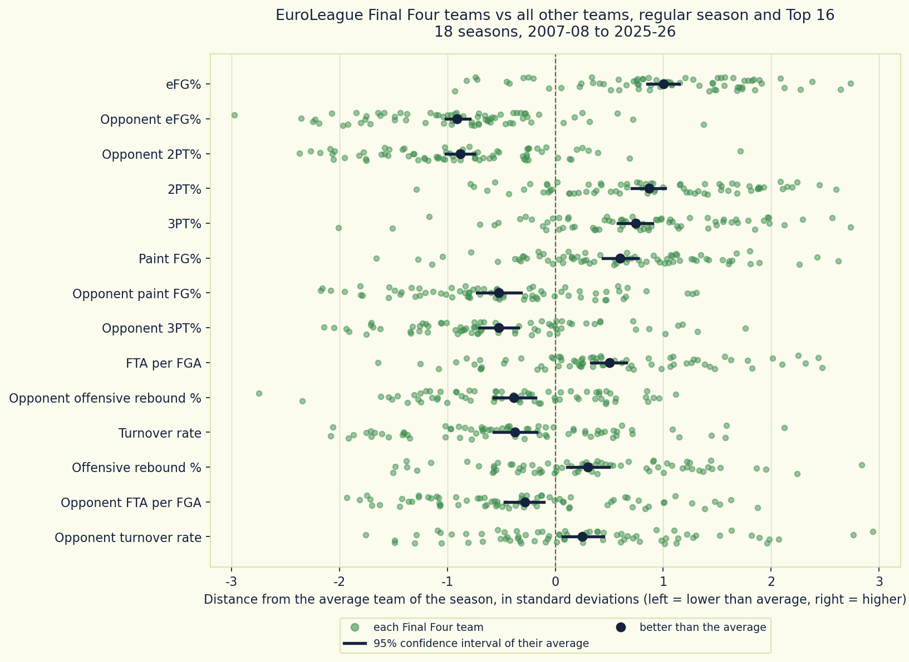
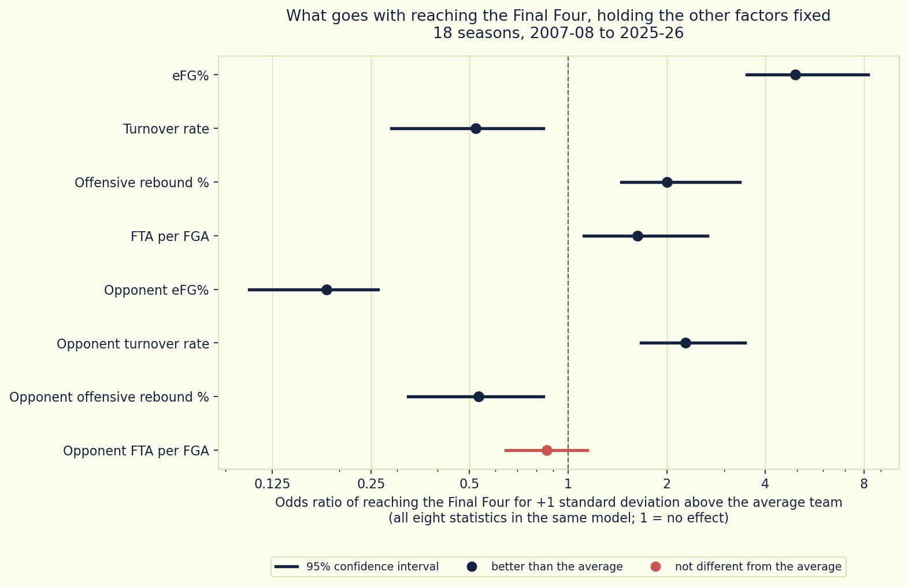

# What does it take to reach the EuroLeague Final Four?

An analysis of the 72 teams that reached the Final Four in 18 EuroLeague seasons (2007-08 to 2025-26), compared with all other teams of their season, using regular season and Top 16 box score and shot data. It combines a descriptive comparison (distance from the season average, in standard deviations) with a logistic regression and a leave-one-season-out prediction test.

**Brief report:** [open the report](https://htmlpreview.github.io/?https://github.com/viare21/reaching-EL-F4/blob/main/final_four_report.html)

## Results in brief

1. Teams that reach the Final Four are clearly better than the season average on all 14 statistics compared (the terms are explained in "How to read the statistics" below). The biggest gaps are in shooting: effective field goal percentage (eFG%) is +1.0 standard deviations above average (interval +0.85 to +1.15), and opponent eFG% is 0.9 below (-1.02 to -0.79).
2. The smaller gaps are in the other "four factors": offensive rebounds (+0.30), turnover rate (-0.37), opponent offensive rebounds (-0.39) and turnovers forced (+0.25). They are smaller, but their intervals do not include zero.
3. In a logistic regression with eight statistics at the same time, eFG% and opponent eFG% remain by far the strongest: +1 standard deviation of eFG% multiplies the odds of reaching the Final Four by 4.9 (3.5 to 8.2), and +1 standard deviation of opponent eFG% divides them by about 5 (odds ratio 0.18, 0.11 to 0.26). The only statistic whose interval includes 1 is opponent free throw attempts per field goal attempt (0.86, 0.64 to 1.14).
4. Test set accuracy: the logistic regression with the eight statistics is fitted on 17 seasons (training set) and used to pick the four teams it considers most likely to reach the Final Four in the 18th season (test set). Repeated for each season, it finds on average 2.9 of the 4 real Final Four teams (95% interval 2.7 to 3.0). Picking 4 teams at random would find 0.8 on average, because with about 20 teams per season each team has about a 1 in 5 chance of being a Final Four team. In 16 seasons out of 18 the model finds exactly 3 of the 4, in the other 2 it finds 2, and it never finds all 4. Random picks would find 3 or more in only about 1 season out of 70.
5. The same analysis was tried for the 18 champions only. Like all Final Four teams, they shoot well (eFG% 2.5 points above the season average), but they are in line with the average on offensive rebounds (+0.3 points, interval -0.9 to +1.4), turnovers forced and opponent offensive rebounds. Several regression factors have an odds ratio whose interval includes 1, and compared with the other three Final Four teams the champions show no clear difference on any statistic. With 18 champions the intervals are wide, so this means that the data do not show a difference, not that there is none.

## How to read the statistics

**The statistics.** Each one is measured for the team and, in the same way, for its opponents, which describes the team's defence. For the opponents' statistics, lower is better, except for the opponent turnover rate, where higher is better because those are turnovers the team forced. They are the "four factors" of basketball analytics (shooting, turnovers, rebounding, free throws), plus 2-point, 3-point and paint shooting.

- **eFG% (effective field goal percentage):** shooting percentage that counts a 3-pointer as worth 1.5 two-pointers (PM = made, FGA = attempted):

$$
\text{eFG} = \frac{2\text{PM} + 1.5 \cdot 3\text{PM}}{\text{FGA}}
$$

- **2PT%, 3PT%:** made shots over attempted shots, for 2-point and 3-point shots. **Paint FG%** is the same for 2-point shots taken inside the key (found from the shot coordinates).
- **Turnover rate:** the share of a team's possessions that end in a turnover (the 0.44 is the usual estimate of how many free throw attempts end a possession):

$$
\text{TOV rate} = \frac{\text{TOV}}{\text{FGA} + 0.44\,\text{FTA} + \text{TOV}}
$$

- **Offensive rebound % (ORB rate in the formula):** the share of a team's missed shots that it recovers:

$$
\text{ORB rate} = \frac{\text{ORB}}{\text{ORB} + \text{opponent DRB}}
$$

- **FTA per FGA:** free throw attempts for each field goal attempt, how often a team gets to the line.

**The statistical terms.**

- **Standard deviation (SD) and distance from the season average:** the SD measures how far teams typically are from the average of their season. A team at +1 SD is as far above the average as a typical team is from it. This puts statistics with different units on the same scale: for eFG%, 1 SD is about 2.7 percentage points, for offensive rebound % it is 3.0.
- **95% interval (bootstrap):** every number comes from only 18 seasons, so it would change with other seasons. To see by how much, the 18 seasons are resampled at random with replacement 5,000 times, the number is recomputed each time, and the interval is the range holding the middle 95% of those values. It is a plausible range for the true value. If a gap from the season average has an interval that does not include zero, the gap is unlikely to be due to chance alone.
- **Training set, test set, cross-validation:** a model always fits the data it has seen better than new data. To check how it does on new data, it is fitted on a training set and then tried on a test set it has not seen. Here the test set is one whole season and the training set is the other 17, repeated for each season (leave-one-season-out cross-validation).
- **Random picks:** the baseline for the test set. It is what you get by choosing 4 teams at random in each season.
- **AUC:** the probability that a team that reached the Final Four is ranked higher by the model than one that did not. 0.5 means no skill (a coin flip) and 1 means a perfect ranking.
- **Likelihood ratio test:** compares a simple model with a larger one that includes extra statistics, and asks whether the larger one fits the data better than chance would explain.
- **p-value:** the probability of a result at least this extreme if there were no real effect. A small one (for example below 0.05) means chance alone is an unlikely explanation. It is not the probability that the effect is real, and it does not say how large the effect is.
- **Multiple comparisons:** if you test many statistics, a few will look different from the average just by luck, like a coin that lands heads several times in a row if you toss enough coins. This analysis compares 14 statistics and does not correct for that. So one isolated result is a hint, while a pattern that repeats across many statistics, as the shooting results do, is more reliable.

## Data

Source: [Euroleague & Eurocup Datasets](https://www.kaggle.com/datasets/babissamothrakis/euroleague-datasets) (Kaggle). 5,039 games, seasons `E2007` to `E2025` (2019-20 was canceled, so there is no Final Four for `E2019`).

| File | Columns used |
|---|---|
| `euroleague_header.csv` | `game_id` (its order gives the game order), `season_code`, `phase`, team ids, scores |
| `euroleague_box_score.csv` | team totals (`dorsal == 'TOTAL'` rows): shots, rebounds, turnovers, free throws |
| `euroleague_comparison.csv` | fast break, second chance and turnover points (not in the main charts, see below) |
| `euroleague_points.csv` | shot coordinates, used to find 2-point shots inside the paint |

The Final Four teams of each season are the four teams that played the last games of the season (two semifinals, the final, and the third-place game when it exists). The champion is the winner of the last game. Season `E2025` has 3 Final Four games in the data, and its four teams are identified from them.

Only games of the phases `REGULAR SEASON`, `TOP 16` and `TOP SIXTEEN` are used. Play-off, play-in and Final Four games are left out, so the statistics describe how teams performed before the games that decide who qualifies. 392 team-seasons with at least 10 games enter the comparison, and the 374 team-seasons of seasons with a Final Four enter the regression.

## Project structure

| File | Role |
|---|---|
| `euroleague_final_four_profile.py` | Main script: champions and Final Four teams, team-game table, team-season statistics, comparisons, regression, charts |
| `images/` | Charts used in the report and in this README (created by the script if missing) |
| `results/` | Result tables (csv) behind the charts and the report (created by the script if missing) |
| `results/title_analysis/` | The same analysis for the 18 champions only, and a look at the Final Four games, with charts and tables. Not in the report |
| `final_four_report.html` | Brief report with the narrative and the findings |

The data files are not included in the repository. They are read from a `csv_euroleague` folder placed next to the project folder.

## How it works

The script is organised in numbered sections, run top to bottom.

1. **Load and champions (1-2).** Header, box score, comparison and shot files. Champions and Final Four teams are identified from the game order.
2. **Team-game table (3).** One row per team per game. The official team line (`TOTAL`) is used, never summed with the players. The margin uses the official score.
3. **Data checks (3.1).** See the next section.
4. **Team-season statistics (4).** Pooled ratios over all the games of a team in a season: effective FG% = (2PM + 1.5 x 3PM) / FGA; 2PT%; 3PT%; paint FG% (2-point shots inside the key, from the shot coordinates); turnover rate = TOV / (FGA + 0.44 FTA + TOV); offensive rebound % = own offensive rebounds / (own offensive rebounds + opponent defensive rebounds); FTA per FGA. The same statistics are computed for the opponents of each team, which describes its defence.
5. **Distance from the season average (5-6, 13).** Each statistic is standardised within its season: the team's value minus the season mean, divided by the standard deviation across the teams of that season (at least 10 games). One value is 1 standard deviation (SD) above the season average. For eFG% one SD is about 2.7 points. Intervals are bootstrap (5,000 draws, fixed seed 42) over seasons: the four Final Four teams of a season are averaged, and the 18 seasons are resampled.
6. **Logistic regression (11-12).** Outcome: 1 if the team reached the Final Four, 0 otherwise. Predictors: the eight statistics (the four factors for the team and for its opponents) as standardised distances from the season average, so the odds ratio is for +1 SD above the average, in the real direction of each statistic. Fitted with a ridge penalty (C = 1), because 72 events and eight correlated predictors make the plain fit unstable. Intervals by bootstrap over seasons (1,000 draws). A plain logistic fit is also in the script and gives the same pattern.
7. **Training set and test set (12).** For each season the model is fitted on the other 17 seasons (training set) and ranks the teams of the missing season (test set), which it has not seen. The test counts how many of the 4 real Final Four teams are in its top 4. This is repeated for the 18 seasons. It is a leave-one-season-out cross-validation (leave-one-group-out), not a leave-one-out on single team-seasons: the teams of a season are compared with each other and share the same season average, so leaving out one team only would keep its season mates in the training set and make the test too optimistic.
8. **Robustness checks (14).** Test set accuracy against random picks, likelihood ratio tests, the model fitted separately on two eras, dropping one season at a time, and the gaps expressed in real units.
9. **Title analysis (6-11, in `results/title_analysis/`).** The same comparison and regression with the 18 champions as outcome, plus a comparison with the other three Final Four teams and a look at the 54 Final Four games.

### Design choices

- Point differential is not used as a predictor: it is the result of winning more than losing, not a characteristic of the team.
- Only the "four factors" are in the regression. With 72 events, a bigger model would be unstable.
- Fast break, second chance and turnover points are not in the report. The dataset has them from 2015-16 on only (with gaps in that season), so they cover about 9 seasons. In that subset the champions are in line with the average on fast break, second chance and turnover points. The one exception is that they concede fewer points off turnovers (about 0.7 standard deviations better than average, interval +0.17 to +1.13), which is one of 21 comparisons and is not significant after correcting for multiple comparisons.
- Playoff games are left out of the statistics so that the outcome (qualifying through the playoffs) does not feed the predictors.

## Data quality checks

| Check | Result |
|---|---|
| Team-game rows | 10,078 for 5,039 games (2 per game) |
| Team `TOTAL` points different from the official score | 1 team row (the official score is used for the margin) |
| Shot rows with placeholder coordinates (0, 0), dropped from paint figures | 551 |
| Fast break, second chance and turnover points missing (both teams at 0) | all games of 2007-08 to 2014-15, about 25% of 2015-16 |
| Champions missing from the comparison | 0 |

## Outputs

`images/final_four_teams_vs_league.png`: each green dot is a Final Four team, the bar is the 95% interval of the average. Left of zero is lower than the season average, right is higher. Black means clearly better than the average.

| Statistic | Mean distance from the season average (SD) | 95% interval | Final Four teams better than average |
|---|---|---|---|
| eFG% | +1.00 | +0.85 to +1.15 | 62 of 72 |
| Opponent eFG% | -0.91 | -1.02 to -0.79 | 65 of 72 |
| Opponent 2PT% | -0.88 | -1.01 to -0.75 | 63 of 72 |
| 2PT% | +0.87 | +0.71 to +1.02 | 58 of 72 |
| 3PT% | +0.74 | +0.58 to +0.90 | 59 of 72 |
| Paint FG% | +0.60 | +0.44 to +0.76 | 55 of 72 |
| Opponent paint FG% | -0.53 | -0.73 to -0.32 | 53 of 72 |
| Opponent 3PT% | -0.52 | -0.70 to -0.34 | 53 of 72 |
| FTA per FGA | +0.50 | +0.33 to +0.66 | 54 of 72 |
| Opponent offensive rebound % | -0.39 | -0.57 to -0.19 | 49 of 72 |
| Turnover rate | -0.37 | -0.57 to -0.17 | 49 of 72 |
| Offensive rebound % | +0.30 | +0.11 to +0.50 | 45 of 72 |
| Opponent FTA per FGA | -0.28 | -0.47 to -0.11 | 48 of 72 |
| Opponent turnover rate | +0.25 | +0.07 to +0.45 | 41 of 72 |

Statistics where lower is better (turnover rate, opponent shooting and opponent free throws, opponent offensive rebounds) appear on the left in the chart. The last column counts teams better than average in the right direction.

`images/final_four_regression.png`: odds ratio of reaching the Final Four for +1 SD above the average team, all eight statistics in the same model. 1 means no effect. Statistics where lower is better have an odds ratio below 1.

| Statistic | Odds ratio per +1 SD above average | 95% interval | Better direction |
|---|---|---|---|
| eFG% | 4.94 | 3.51 to 8.24 | higher |
| Turnover rate | 0.52 | 0.29 to 0.84 | lower |
| Offensive rebound % | 2.00 | 1.45 to 3.34 | higher |
| FTA per FGA | 1.63 | 1.11 to 2.66 | higher |
| Opponent eFG% | 0.18 | 0.11 to 0.26 | lower |
| Opponent turnover rate | 2.28 | 1.67 to 3.47 | higher |
| Opponent offensive rebound % | 0.53 | 0.32 to 0.84 | lower |
| Opponent FTA per FGA | 0.86 | 0.64 to 1.14 | lower |

Test set results (18 seasons, each one predicted by a model fitted on the other 17):

| Model | Real Final Four teams in the top 4 (average per season) | Random picks | Seasons with 3 or 4 found | AUC |
|---|---|---|---|---|
| Four factors, both sides (8) | 2.89 | 0.79 | 16 | 0.94 |
| Shooting only: eFG% and opponent eFG% (2) | 2.72 | 0.79 | 11 | 0.91 |
| Offence only (4) | 2.44 | 0.79 | 8 | 0.89 |
| Defence only (4) | 2.11 | 0.79 | 7 | 0.84 |

## The logistic regression: formula and how to read it

For each team-season $i$, let $p_i$ be the probability that the team reaches the Final Four. The model is:

$$
\log\left(\frac{p_i}{1-p_i}\right) = \beta_0 + \beta_1\,z_{i,\text{eFG}} + \beta_2\,z_{i,\text{TOV}} + \beta_3\,z_{i,\text{ORB}} + \beta_4\,z_{i,\text{FTA}} + \beta_5\,z_{i,\text{opp eFG}} + \beta_6\,z_{i,\text{opp TOV}} + \beta_7\,z_{i,\text{opp ORB}} + \beta_8\,z_{i,\text{opp FTA}}
$$

where each $z$ is the distance of the team from the average of its season, in standard deviations: $z = 0$ means exactly average on that statistic, $z = +1$ means one standard deviation above average.

$$
z = \frac{x_{\text{team}} - \mu_{\text{season}}}{\sigma_{\text{season}}}
$$

Here $x_{\text{team}}$ is the team's value of the statistic, $\mu_{\text{season}}$ is the average of that statistic across the teams of the season, and $\sigma_{\text{season}}$ is their standard deviation.

How to read it:

- **Odds** compare the chance that something happens with the chance that it does not: a 20% chance means odds of 1 to 4 (0.25), 50% means 1 to 1, and 80% means 4 to 1. The model works on the logarithm of the odds because a probability must stay between 0 and 1, while the right-hand side of the formula can take any value.
- $\beta$ is multiplied by $z$ because the right-hand side is a weighted sum: $\beta$ is the weight that the model gives to a statistic, and $z$ is how far the team is from average on it, so $\beta \cdot z$ is the contribution of that statistic to the log-odds of the team. A team exactly average on a statistic ($z = 0$) gets nothing from it, a team one standard deviation above average gets $\beta$, and one two standard deviations above gets $2\beta$. $\beta_0$ is the log-odds of a team that is exactly average on all eight statistics.
- The coefficients $\beta$ are on a log scale, which is hard to read, so the tables show their exponential, the **odds ratio** (OR):

$$
\text{OR}_j = e^{\beta_j}
$$

  Adding $\beta$ to the log-odds is the same as multiplying the odds by the odds ratio. So the odds ratio is the factor by which the odds are multiplied for +1 standard deviation of that statistic, with the other seven fixed.
  - Odds ratio **1**: no effect.
  - Odds ratio **above 1**: the higher the statistic, the more likely the team reaches the Final Four. Example, eFG% (OR 4.9): the model gives a team that is average on all eight statistics a 3% chance of reaching the Final Four (odds of about 0.03). With an eFG% one standard deviation higher, about 2.7 points, its odds become 0.03 x 4.9 = 0.15, which is a 13% chance of reaching the Final Four. With two standard deviations (about 5.4 points) it is about 43%.
  - Odds ratio **below 1**: the higher the statistic, the less likely. Example, opponent eFG% (OR 0.18): every extra standard deviation of opponent eFG% (about 2.5 points) multiplies the odds by 0.18. Read the other way, if the opponents shot one standard deviation worse than average, the odds are multiplied by 1 / 0.18 = 5.5, and the same average team goes from a 3% to a 14% chance of reaching the Final Four.
  - **The same odds ratio does not add the same percentage points to every team.** It multiplies the odds, so the effect depends on the probability the team had before the change. With an odds ratio of 4.9, a team with a 5% chance goes to 21%, one with 20% goes to 55%, and one with 50% goes to 83%.
- The 95% interval comes from resampling seasons (see the glossary). If it does not include 1, the statistic is clearly associated with reaching the Final Four.
- The model is fitted with a **ridge penalty**: it slightly shrinks the coefficients toward zero. With 72 events and eight correlated statistics, a plain fit gives unstable coefficients, and the penalty keeps them from becoming extreme.
- The tables and charts show the odds ratios in the real direction of each statistic. For turnover rate and for the opponents' shooting, rebounds and free throws, lower is better, so a good value is an odds ratio below 1.
- These are associations. With correlated statistics, an odds ratio describes the effect of one statistic with the others held fixed, which in practice rarely happens alone.

## Can we predict who reaches the Final Four?

The best test of a model is to see whether it works on data it has never seen. For each of the 18 seasons, using only regular season and Top 16 statistics (everything that comes before the play-offs that decide who qualifies):

1. hide that season;
2. fit the model on the other 17 seasons (training set);
3. give the model the statistics of the teams of the hidden season (test set, about 20 teams) and let it pick the four with the highest probability of reaching the Final Four;
4. compare these four picks with the four teams that really got there.

The model found, on average, 2.9 of the 4 real Final Four teams per season (95% interval 2.7 to 3.0). In 16 seasons out of 18 it found exactly 3 of the 4, in the other 2 it found 2, and it never found all 4. For example, in 2024-25 it picked Anadolu Efes, Olympiacos, Panathinaikos and Monaco, and the real Final Four were Monaco, Olympiacos, Panathinaikos and Fenerbahce.

Picking 4 teams at random finds 0.8 on average: with about 20 teams, each has roughly 1 chance in 5, so 4 random picks contain 0.8 real ones. At random, finding 3 or more happens in only about 1 season out of 70. In 20,000 simulated random draws the best average was 1.56, far from 2.9 (p < 0.001).

## Robustness of the Final Four results

How stable and how large are the effects?

**Size of the gaps in real units.** A standard deviation is only a way of comparing statistics. In the units of each statistic, the gaps of the Final Four teams from the season average are:

| Statistic | Gap vs season average (percentage points) | 95% interval | One SD (percentage points) |
|---|---|---|---|
| eFG% | +2.75 | +2.18 to +3.34 | 2.65 |
| Opponent eFG% | -2.27 | -2.66 to -1.89 | 2.45 |
| 2PT% | +2.46 | +1.91 to +3.04 | 2.74 |
| 3PT% | +2.14 | +1.58 to +2.68 | 2.77 |
| FTA per FGA | +1.84 | +1.14 to +2.50 | 3.74 |
| Opponent FTA per FGA | -1.29 | -2.20 to -0.44 | 4.62 |
| Offensive rebound % | +0.88 | +0.21 to +1.51 | 3.01 |
| Opponent offensive rebound % | -0.93 | -1.33 to -0.52 | 2.38 |
| Turnover rate | -0.60 | -0.91 to -0.29 | 1.47 |
| Opponent turnover rate | +0.42 | +0.12 to +0.75 | 1.46 |

The shooting gaps are large: about 2.7 points of eFG% above average, and 2.3 points of eFG% below for the opponents. The gaps in rebounds, turnovers and free throws are modest (for example 0.9 points of offensive rebound percentage, or 0.6 points of turnover rate). They are different from zero, but they are small compared with the shooting gaps.

**Checks.**

1. **Do the six extra statistics improve the picks?** Not clearly. The full model finds 0.17 more teams per season than the model with only eFG% and opponent eFG% (2.89 against 2.72), and the interval of this difference (-0.22 to +0.56) includes zero.
2. **Do the other statistics add to shooting?** A likelihood ratio test on the six other statistics, compared with a model with only the two shooting statistics, gives chi-square 53.6 on 6 degrees of freedom (p < 0.001). Adding one at a time: offensive rebounds (p < 0.001), turnovers forced (p = 0.0002), FTA per FGA (p = 0.0035) and turnover rate (p = 0.016) add information. Opponent offensive rebounds are borderline (p = 0.050), and opponent FTA per FGA adds nothing (p = 0.74). These tests treat each team-season as independent and are not corrected for multiple comparisons.
3. **Two eras.** The model fitted separately on 2007-08 to 2015-16 and on 2016-17 to 2025-26 (36 Final Four teams each) gives the same direction for all the statistics. The odds ratio of eFG% is 5.1 and 5.3, and that of opponent eFG% is 5.3 and 5.5 (in the better direction). The two weaker ones vary more: FTA per FGA 1.15 against 2.51, and opponent FTA per FGA 0.99 against 1.31.
4. **Dropping one season at a time.** The odds ratios stay in a narrow range (eFG% from 4.4 to 5.3, offensive rebound % from 1.8 to 2.3, turnover rate from 1.7 to 2.2) and no statistic changes direction, so no single season drives the results.

In short: the effect of shooting is large and stable. The effects of rebounds, turnovers and free throws are modest in size, but have the same direction in both eras and in every leave-one-season-out fit.

## How to run

1. Download the dataset from Kaggle and place the CSV files in a folder named `csv_euroleague`, one level above this project's folder.
2. Install the requirements: `pip install pandas numpy matplotlib scipy scikit-learn statsmodels`
3. Run `euroleague_final_four_profile.py`.

In Spyder, press F5 to run the whole file. Running cell by cell (F9) also works: if `__file__` is not defined, the script falls back to the current working directory, so set it to the project folder first.

## Limitations and possible extensions

- The analysis is observational and descriptive. It says what teams that reach the Final Four have in common, not that improving a statistic would take a team there.
- The Final Four teams are among the best of the season, so these statistics partly measure "being a strong team". The comparison cannot separate that from the effect of any single statistic.
- The statistics are correlated (a team that shoots well also tends to score in the paint), so single odds ratios in the regression should be read with caution.
- Many statistics are compared at once. The intervals are not corrected for multiple comparisons, and the likelihood ratio tests treat team-seasons as independent.
- The title analysis has only 18 champions. A statistic in line with the average, or an odds ratio whose interval includes 1, means the data do not show a difference. It does not prove there is none. In the champions-only analysis the largest gaps are again in shooting (eFG% 2.5 points above the season average, interval 1.7 to 3.5) and in free throw attempts (3.2 more per 100 field goal attempts). Compared with the other three Final Four teams of their season, the champions show no clear difference on any statistic.
- The Final Four is three single games in three days and is treated as a closed box: no conclusion is drawn about the games themselves.
- Possible extensions: the same analysis with easy points once more seasons are available, season-specific effects (the format changed in 2016-17), and adding roster or player information.
